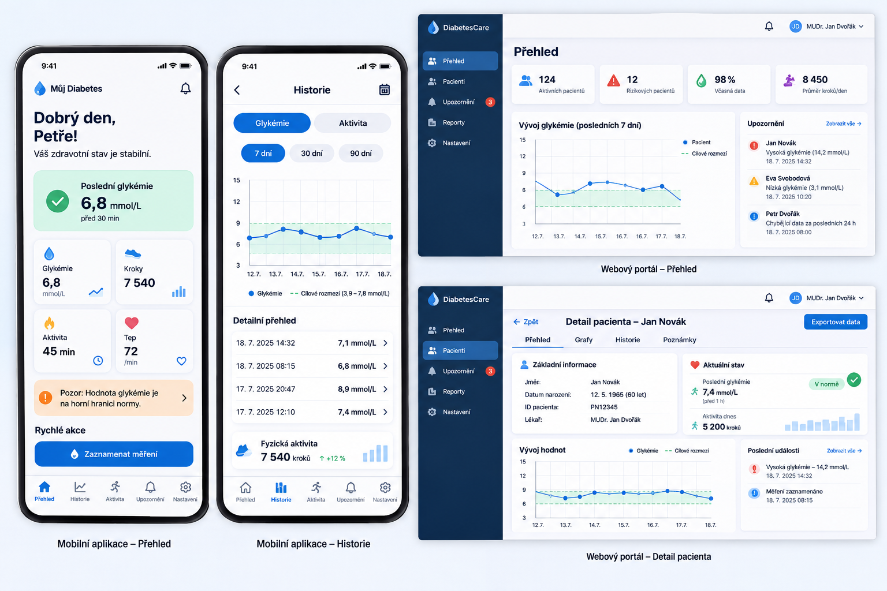

# Návrh mobilní aplikace, webového portálu a implementačních technologií

**Telemedicínský systém pro pacienty s diabetem mellitus 2. typu**

## 1. Úvod

Tato část projektu se zabývá návrhem mobilní aplikace pro pacienty a webového portálu pro lékaře. Systém je určen pro pacienty s diabetem mellitus 2. typu. Jeho hlavním účelem je zobrazovat naměřené hodnoty glykémie, sledovat fyzickou aktivitu a umožnit lékaři kontrolovat vývoj zdravotního stavu pacienta. Návrh počítá s tím, že data z mobilní aplikace a webového portálu budou ukládána na společném serveru.

## 2. Návrh mobilní aplikace

Mobilní aplikace bude určena především pacientovi. Měla by být jednoduchá a přehledná, aby se v ní dokázal snadno orientovat i uživatel, který nemá mnoho zkušeností s chytrým telefonem. Po přihlášení se zobrazí hlavní obrazovka s poslední naměřenou hodnotou glykémie, základním přehledem fyzické aktivity a případnými upozorněními.

V aplikaci počítám s těmito hlavními obrazovkami:

- **Přihlášení** – zadání přihlašovacích údajů pacienta.
- **Přehled** – poslední měření glykémie, počet kroků, aktivita a aktuální upozornění.
- **Historie měření** – seznam starších měření a graf vývoje glykémie podle zvoleného období.
- **Fyzická aktivita** – přehled kroků a pohybové aktivity za den nebo delší období.
- **Upozornění** – informace o neobvyklých nebo rizikových hodnotách a o chybějících datech.
- **Nastavení a profil** – základní údaje o pacientovi a nastavení aplikace.

Měření glykémie by se do aplikace mělo načítat z podporovaného glukometru, například pomocí Bluetooth. Konkrétní způsob připojení bude záviset na vybraném modelu glukometru, protože jednotliví výrobci mohou používat rozdílné způsoby komunikace. Pokud se měření nepodaří odeslat na server, aplikace by ho měla dočasně uložit a pokusit se odeslání zopakovat později.

Fyzickou aktivitu bude možné získávat z podporovaných zdravotních služeb telefonu. Na Androidu lze počítat s Health Connect a na iPhonu s Apple HealthKit. Aplikace si před čtením těchto údajů vyžádá souhlas pacienta. Pacient bude mít také možnost zobrazit si, jaké údaje aplikace používá.

## 3. Grafický návrh aplikace a webového portálu

Následující obrázek představuje předběžný návrh hlavních obrazovek. Vlevo jsou ukázky mobilní aplikace pro pacienta a vpravo webový portál pro lékaře. Jde o ilustrační návrh, nikoliv o finální podobu aplikace.



*Obrázek 1 – Předběžný návrh mobilní aplikace a webového portálu.*

## 4. Návrh webového portálu

Webový portál bude sloužit hlavně lékařům a případně administrátorům. Lékař se po přihlášení dostane na přehled svých pacientů. U každého pacienta bude možné otevřít detail a zobrazit jeho naměřené hodnoty, historii glykémie, fyzickou aktivitu a upozornění.

Základní části webového portálu budou:

- **Přehled pacientů** – seznam pacientů, vyhledávání a filtrování.
- **Detail pacienta** – základní informace a poslední naměřené hodnoty.
- **Grafy** – vývoj glykémie a fyzické aktivity za vybrané období.
- **Upozornění** – přehled pacientů, u kterých systém zaznamenal rizikovou hodnotu nebo chybějící data.
- **Poznámky a záznamy** – možnost doplnit poznámku k pacientovi podle oprávnění lékaře.

Pacient uvidí pouze svoje vlastní údaje. Lékař bude mít přístup pouze k pacientům, které má přiřazené. Administrátor bude spravovat uživatele a jejich oprávnění. Webový portál nebude přistupovat přímo do databáze, ale bude komunikovat se serverem pomocí WEB API.

## 5. Návrh implementačních technologií

Technologie jsem vybíral tak, aby spolu jednotlivé části systému mohly jednoduše komunikovat. Zároveň navazuji na předběžný návrh backendu, kde se počítá s Pythonem, FastAPI a databází PostgreSQL.

### Mobilní aplikace

Pro mobilní aplikaci navrhuji Flutter a programovací jazyk Dart. Výhodou je, že pomocí jednoho řešení lze připravit aplikaci pro Android i iOS. Flutter umožňuje také využívat funkce telefonu, například Bluetooth nebo přístup ke zdravotním údajům. Pro komunikaci s glukometrem bude potřeba vybrat knihovnu podle konkrétního zařízení.

### Webový portál

Pro webový portál navrhuji React s TypeScriptem. React bude sloužit k tvorbě jednotlivých částí rozhraní a TypeScript pomůže při práci s daty a omezí některé chyby v kódu. Pro základní vzhled komponent lze použít Material UI a pro grafy knihovnu Recharts. Pro spuštění a sestavení webové aplikace lze použít Vite.

### Server a databáze

Mobilní aplikace i webový portál budou komunikovat se serverem přes REST API. Pro backend se předběžně počítá s Pythonem a frameworkem FastAPI. Data se budou posílat ve formátu JSON a komunikace bude probíhat přes HTTPS. Pro ukládání dat bude použita databáze PostgreSQL. Tuto část návrhu bude dále upřesňovat člen týmu odpovědný za backend a databázi.

### Další použité technologie

- **Git a GitHub** – ukládání a verzování zdrojového kódu.
- **GitHub Actions** – automatické spouštění testů a kontrola změn.
- **Docker** – příprava a spuštění serverových částí v oddělených kontejnerech.
- **HL7 FHIR** – standard pro předávání zdravotnických dat do nemocničního informačního systému.

## 6. Způsob propojení částí systému

Pacientská aplikace bude získávat hodnoty z glukometru a údaje o fyzické aktivitě. Následně je odešle přes zabezpečené REST API na server, kde se uloží do databáze. Lékař si data zobrazí ve webovém portálu, který používá stejné API. Samostatný integrátor bude zajišťovat předávání vybraných údajů do NIS pomocí HL7 FHIR.

Zjednodušený tok dat:

```text
Glukometr / aktivita
        ↓
Mobilní aplikace
        ↓
REST API
        ↓
PostgreSQL
        ↓
Webový portál lékaře

PostgreSQL
        ↓
FHIR integrátor
        ↓
Nemocniční informační systém (NIS)
```

## 7. Shrnutí

Navržené řešení se skládá z mobilní aplikace pro pacienta a webového portálu pro lékaře. Mobilní aplikace zajistí sběr a zobrazení údajů o glykémii a fyzické aktivitě. Webový portál umožní lékaři sledovat pacienty a kontrolovat vývoj jejich hodnot. Pro mobilní část navrhuji Flutter, pro web React a TypeScript a pro server FastAPI s PostgreSQL. Jde o předběžný návrh, který se může při dalším rozpracování projektu ještě upravit.
